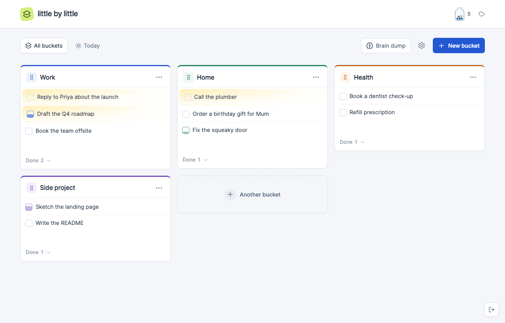
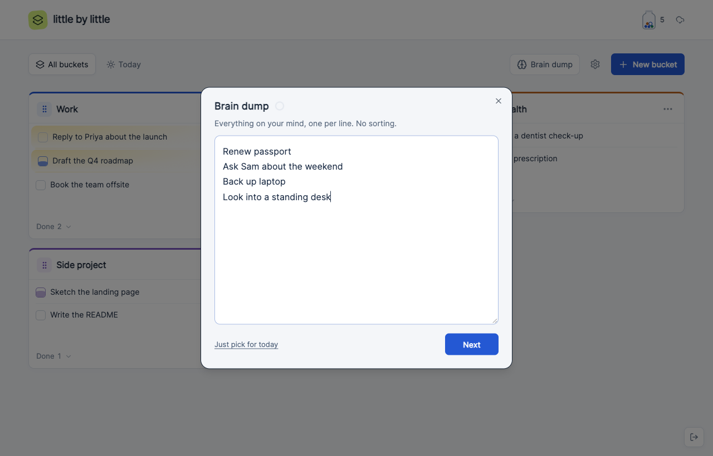
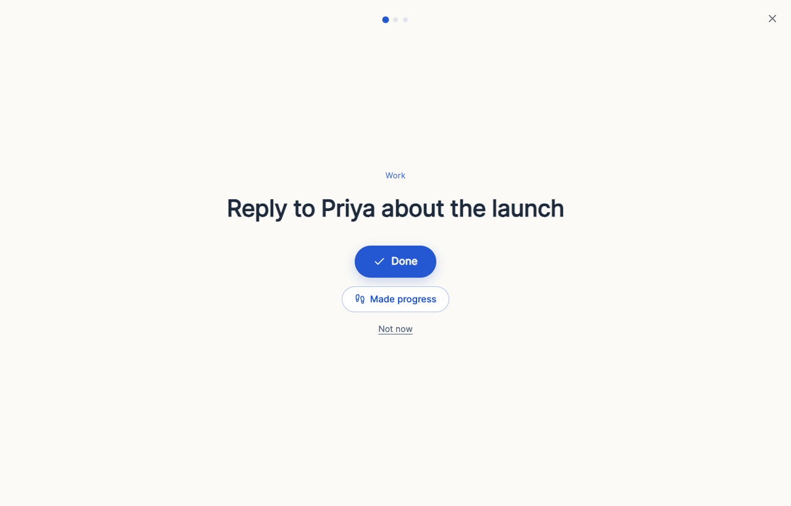
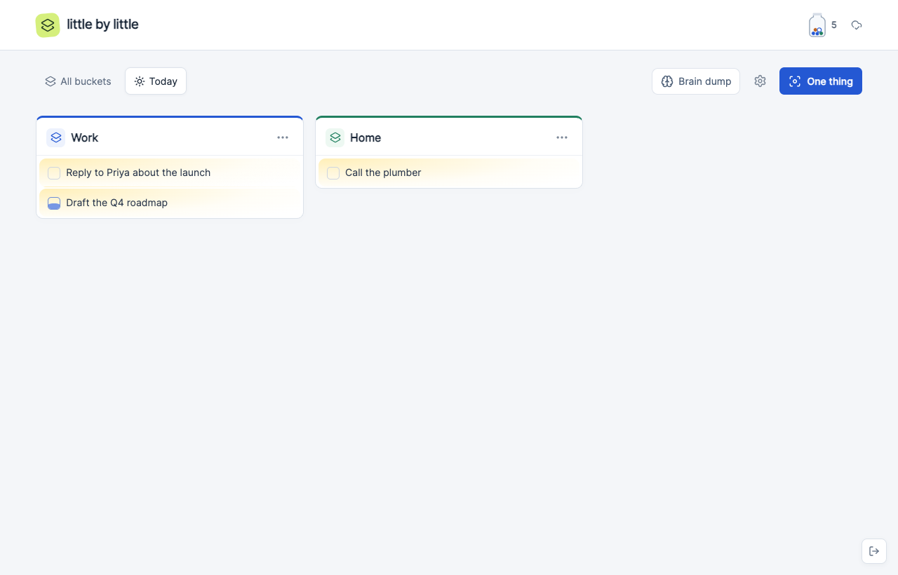
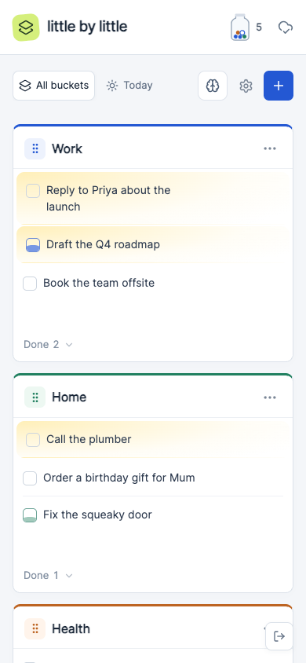

# Little by Little

A calm, private to-do board designed for ADHD brains. Empty your head, pick up to three things, and do one at a time.

[](https://app.instapods.com/dashboard/pods/create?app=little-by-little)



## Why it looks like this

Most to-do apps are built to show you everything. This one is built to show you less.

- **Quiet at rest.** Task icons, the add line and menus only appear when you reach for them. Nothing blinks, counts down or turns red.
- **Today is small and resets itself.** Picks for today clear at midnight, so unfinished ones never pile up as guilt.
- **Partial progress counts.** A task you worked on but didn't finish slowly fills its checkbox, a little more each day.
- **Old things leave on their own.** Items expire after 15 days (configurable). They move to an archive you can restore from, not to a growing backlog.
- **Small, honest rewards.** Finishing gives a brief burst and drops a pebble into today's wins jar. The jar empties every night, and there are no streaks to lose.

## Features

| | |
|---|---|
|  | **Brain dump.** One big box for everything on your mind, one line each, with no sorting. A quiet ring fills over 15 minutes as a "that's plenty". Lines land in an *Unsorted* bucket, then you **pick up to three** for today. |
|  | **One thing.** Just your next Today task, full screen. Mark it **Done** or **Made progress**, or choose **Not now** to send it to the back of the line. |
|  | **Today.** Only what you picked, with a soft highlight and no icons. It auto-clears after midnight in your time zone. |
|  | **Works on your phone.** It's the same calm layout, with controls always visible on touch screens. |

It also includes:

- **Instant adds.** Tasks appear as soon as you press Enter. Press **N** anywhere to start one, or paste a list to add every line.
- **Buckets.** Group tasks into colour-coded buckets, drag buckets to rearrange them, and move tasks between buckets.
- **Expiry.** In an item's last five days you can bump it by a week.
- **AI agents can use your board.** A token-protected [MCP](https://modelcontextprotocol.io) endpoint lets an assistant read and update it.
- **Reduced motion.** Animation stops when your system asks for reduced motion.

## Run it locally

You need Node.js 22.13 or newer, which includes the built-in `node:sqlite`.

```sh
npm ci
npm run setup:local   # creates .env.local and .local-credentials.json
npm run build
npm run start:local
```

Open http://localhost:3000. Your generated board password is in `.local-credentials.json`. Data is stored in `data/board.sqlite`.

- Run the tests with `npm test`.
- After changing the frontend, run `npm run build` again. The server reads `public/` from disk, so a browser refresh is enough.

## MCP for AI agents

The endpoint is `/mcp`, using Streamable HTTP. Send the agent token from `.local-credentials.json` as `Authorization: Bearer <token>`. The browser password and the agent token are separate credentials.

## Deploying

The quickest way is the **Deploy on InstaPods** button at the top, which sets up a ready-to-run pod in one click.

To host it yourself: it's a single Node process with no external database. In production:

1. Run `npm ci` and `npm run build`, then `npm start`.
2. Set these environment variables:

| Variable | What it holds |
|---|---|
| `BOARD_PASSWORD_HASH` | `salt:hash` from scrypt (see `scripts/setup-local.mjs`) |
| `BOARD_SESSION_KEY` | 32 or more random characters |
| `BOARD_MCP_TOKEN_HASH` | sha256 of the agent token |
| `APP_ORIGIN` | Your public URL |
| `BOARD_DATA_DIR` | Optional. Where `board.sqlite` lives |

3. Serve it over HTTPS. Session cookies are `Secure` unless `NODE_ENV=development`.

## Project layout

| Path | What's in it |
|---|---|
| `src/board.tsx` | Board UI and interactions |
| `src/plan.tsx` | Brain dump and pick-up-to-three |
| `src/focus.tsx` | One thing view |
| `src/wins.tsx` | Completion burst and wins jar |
| `src/expiry.js` | Active and expired filtering |
| `src/main.tsx` | Login and React entry |
| `src/style.css` | All styling |
| `server.mjs` | HTTP server, password sessions, API, static files |
| `board-store.mjs` | SQLite schema, migrations and board operations |
| `board-mcp.mjs` | MCP tools |
| `components/`, `lib/`, `vendor/` | shadcn/Radix UI pieces |
| `tests/` | Store, expiry, migration and MCP tests |

Built with React 19, Vite, Tailwind 4, Radix UI and `node:sqlite`.
